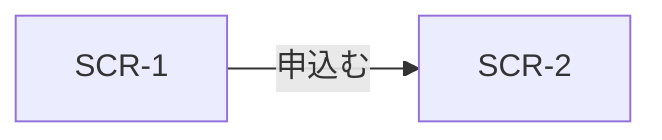

# UX Structure

<!-- design-structure が書く。操作の流れ、画面の一覧、遷移、画面をまたぐ配置の規則を定める。
     画面ごとの詳細は docs/D2/screens/SCR-N.md、見た目（色、書体）は UI_GUIDELINES.md に書く。 -->

## 1. 操作シナリオ

主要な操作ごとに、どの画面から始まり、何手で完了するかを示す。

| ID | シナリオ | ペルソナ | 開始 | 経由する画面 | 手数 | 目標の手数 | 由来 |
|---|---|---|---|---|---|---|---|
| FLW-1 | 例：初回の申込み | PSN-1 | SCR-1 | SCR-1, SCR-2, SCR-3 | 4 | 5以内 | FR-3 |

### FLW-1 の手順

| # | 画面 | 利用者の操作 | システムの反応 | 状態の分岐 |
|---|---|---|---|---|
| 1 | SCR-1 | 「申込む」を押す | SCR-2 に遷移 | 未ログインなら SCR-9 |

## 2. 画面一覧

| ID | 名前 | 主タスク（1つ） | 主なペルソナ | 理由 | 由来 |
|---|---|---|---|---|---|
| SCR-1 | 例：ホーム | 次にやることを選ぶ | PSN-1 | 例：直近の予定を最初に見せる | FR-1 |

- 画面ごとの詳細（領域、状態、操作、文言、実装ルート）は `docs/D2/screens/SCR-N.md` に書く（雛形：design-structure の `references/SCREEN.template.md`）。

## 3. 画面遷移

| 遷移 | きっかけ | 戻り方 | 演出の意図 |
|---|---|---|---|
| SCR-1 → SCR-2 | 「申込む」 | 戻る、左端スワイプ（iOS） | 例：前進を示す（principles#motion-purpose） |

## 4. ナビゲーションと配置の規則

画面をまたいで守る配置と操作の規則。1画面だけの判断は、その画面の詳細設計の「領域」の理由に書く。

| ID | 規則 | 理由 | 由来 |
|---|---|---|---|
| UI-N | 例：モバイルでは主要操作を画面下部に固定する | 例：PSN-1 は片手で操作する（principles#thumb-zone） | PSN-1, FLW-1 |
